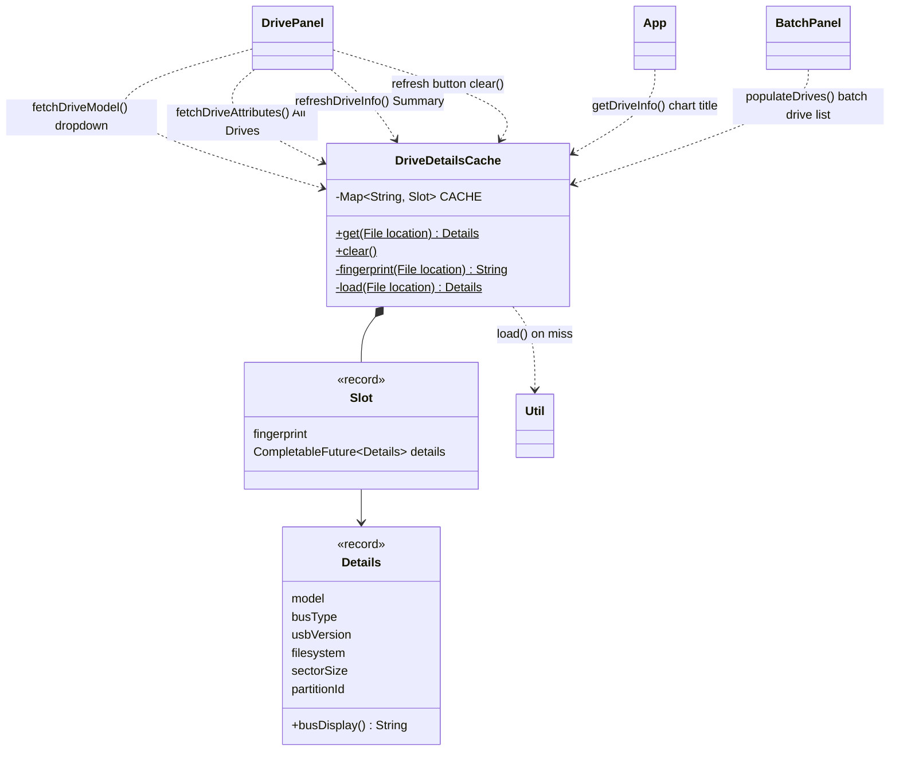
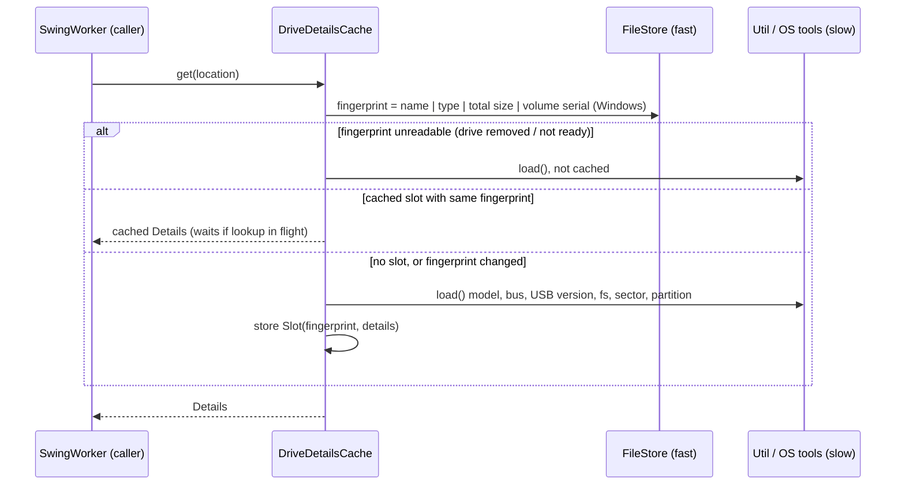

# Design Decisions

## Established GUI behavior
 
- the top section is the active benchmark being run or loaded from history
- the top-left section of the benchmark tab is called the settings controls
- the top-right section of the benchmark is the chart
- the bottom section is the historical list of runs and common status output
- the Total Tx progress bar below the bottom tabs is visible only on the Benchmark tab or while a non-batch benchmark is running; batch runs use their own progress view. Otherwise it is hidden and its space goes to the bottom tabs (`MainFrame.updateProgressPanelVisibility`)

# Active design trades

- loading a benchmark 
    - updates:
        - active control settings
        - options/advanced options
    - running a benchmark immediately after a load will cause the next run to use the loaded benchmark's settings, options, and advanced options

- Benchmark Current/Results View Separation Option: an alternate approach is to separate the current benchmark view from the historical benchmark view so that changing the settings does not affect the loaded benchmark. This way on the active view highlights could be used to indicate deviation from the selected profile instead of indicating they differ from the saved benchmark. the loaded historical benchmark view would be immutable. this alternate approach could split the active benchmark view from a loaded/saved benchmark view tab

if expanded to SMART benchmark view:

Top Panel Tabs
- Drive - active configurable
- Benchmark - active configurable
- Batch - batch drive benchmark (setup → running → results comparison chart)
- Benchmark Results - historical immutable
- SMART - active configurable
- SMART Results - historical immutable

Bottom Panel Tabs (common to all):
- Benchmarks -- linked to benchmark results view
- SMART Reports -- linked to SMART results view
- All Drives -- a unified view of all drives and their status
- Batch Reports -- batch history, selecting loads into Batch top tab
- Events
- Sharing -- controls to share benchmarks to community portal

# Package organization

New classes should be introduced in this structure:

org.metricus.jdm
  - core - benchmark algorithms
  - io - abstract api
  - io.win
  - io.mac
  - io.linux
  - cli - command line interface
  - ui - user interface, themes, palettes
  - util - sharing, logging, export, translation

## Proposed Mapping

**root** — App, EM

**core** — Benchmark, BenchmarkCallable, BenchmarkConfig, BenchmarkDriveInfo,
BenchmarkOperation, BenchmarkProfile, BenchmarkRunner, BenchmarkSystemInfo,
BenchmarkWorker, DiskUsageInfo, GcDetector, RenderFrequencyMode,
Sample, Smart, SmartSnapshot,
GcRetriedSamplesConverter, SampleAttributeConverter, LocalDateTimeAttributeConverter

**io** — DriveChecker, UtilOs (abstract interface)
**io.win / io.mac / io.linux** — platform implementations (split from UtilOs)

**cli** — Cli, RunBenchmarkCommand, VersionProvider

**ui** — Gui, MainFrame, BenchmarkPanel, BenchmarkControlPanel, DrivePanel,
SelectDriveFrame, AdvancedOptionsFrame, SmartPanel, SmartReportsPanel,
SharingPanel, PortalEnableDialog, OperationTableSelectionListener,
CenterTableCellRenderer, RightTableCellRenderer,
ChartPalette, ThemeColors, GraphPaletteMenu, GraphThemeMenu, AppIcon

**util** — Portal, Exporter, Util, RoundingSerializer

Already in `org.metricus.jdm.util`: DriveDetailsCache (per-drive OS lookup
cache for the drive UI, validated by volume fingerprint; see #267)

# Drive details caching

`DriveDetailsCache` (#267) holds the slow per-drive OS lookups (PowerShell,
`lsblk`, `diskutil`) used by the drive UI. Callers run it from `SwingWorker`
background threads, never on the EDT.

- **Key:** mount path (`G:\`, `/run/media/...`). The fingerprint check means a
  drive letter or mount point reassigned to a different device is looked up
  again without pressing ⟳.
- **Not cached:** usage / free space and read/write access are always read fresh.
- **Not used by benchmark or batch runs:** they call `Util` directly so the drive
  details recorded with results are always current.
- **Limitation:** Linux and macOS have no volume serial, so two devices with the
  same mount path, device node, file system and exact size are indistinguishable
  until ⟳ clears the cache.

# Direct I/O file lock on Windows FAT32 / exFAT

**Suspected JDK bug (#260, not yet filed):** on Windows, every
`FileChannel.open(..., ExtendedOpenOption.DIRECT)` leaks a handle.
`FileDispatcherImpl.setDirect0()` calls `ReOpenFile()` to query the sector size
and never closes it. On FAT32/exFAT a deleted file stays pending-delete while
any handle is open, so test files and their folder can't be deleted or
re-created until JDiskMark exits. NTFS is unaffected. The handle lives in the
JVM, so **closing JDiskMark frees it; no reboot is needed.** The same code is in
Oracle JDK and Temurin (both OpenJDK builds). Verify with
`java jdm-core/docs/repro/DirectIoLockRepro.java E:\` (exit code 1 = reproduced).

**Current workarounds (#257):**
- `BenchmarkRunner.checkDirectIoLock()` probes once per location and volume
  serial whether a Direct I/O file can be released; only affected volumes go on.
- The user picks how to proceed (`DirectLockChoice`): **Buffered** (Direct I/O
  off, disk cache cleared before READ), **Keep** (Direct I/O kept, test data
  removed after exit) or **Cancel**. The GUI asks via `Gui.askDirectLockChoice()`;
  the CLI uses `--direct-lock=buffered|keep`.
- Locked test data is registered with `Util.removeDirectoryAfterExit()`, which
  deletes it from a separate process after the JVM exits.
- Batch runs skip affected drives when Direct I/O is on.

**Limits and planned work (#268):** only one Direct I/O run per affected drive
per session (the next run can't delete `jdm-data`). Planned: separate test
folder per run, ask once per batch, prompt to restart JDiskMark only when free
space runs out, and clear leftover folders at startup. Remove the workarounds
once a fixed JDK is the minimum.

# 